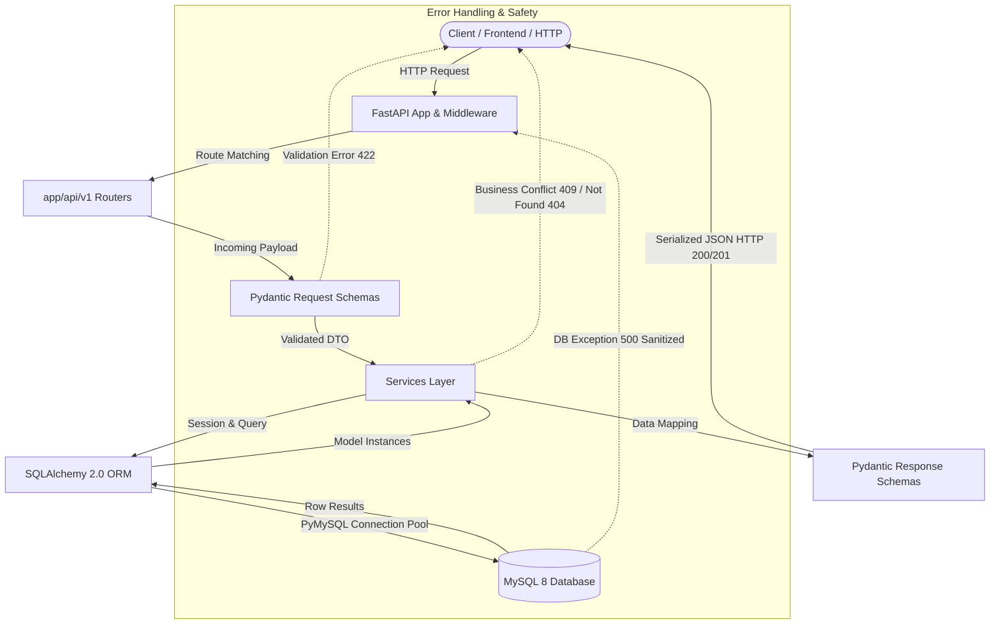

# InsightEngine — System Architecture & Request Lifecycle

## 1. Architectural Overview
InsightEngine is built as a clean **Modular Monolith** adhering to the principles of separation of concerns, transactional safety, and defense-in-depth request validation.

---

## 2. Layer Responsibilities

| Layer | Files | Key Responsibility |
|---|---|---|
| **Entrypoint** | `app/main.py` | FastAPI application initialization, lifespan management, global exception handlers, CORS/logging, router mounting. |
| **Routing** | `app/api/v1/projects.py`, `app/api/v1/reviews.py` | HTTP verb binding, URL parameter parsing, dependency injection (`db`, `pagination`), mapping HTTP status codes. |
| **Validation / DTO** | `app/schemas/` | Type enforcement, string trimming, boundary checking (e.g. rating 1-5), response serialization, schema documentation. |
| **Service Layer** | `app/services/` | Business rules, transaction management, duplicate checks, restrictive deletion checks, CSV parsing and atomicity. |
| **Data Layer** | `app/models/`, `app/db/` | Relational table mapping, foreign keys, database constraints, connection pooling with `pool_pre_ping` and `pool_recycle`. |

---

## 3. End-to-End Walkthrough: Creating a Review

Here is the exact step-by-step lifecycle when a client invokes `POST /api/v1/projects/3/reviews`:

1. **Network & Routing**:
   - The client sends an HTTP `POST` to `/api/v1/projects/3/reviews` with headers `Content-Type: application/json` and JSON body `{"customer_name": "Alice", "rating": 5, "review_text": "Great service!"}`.
   - FastAPI matches the path in `app/api/v1/projects.py:create_project_review`.

2. **Schema Validation**:
   - Pydantic parses the payload into `ReviewCreate`.
   - The field validator `validate_review_text` strips leading/trailing whitespace and ensures the text is not blank.
   - Pydantic validates `rating` with boundary constraints `ge=1, le=5`.
   - If invalid, FastAPI halts processing immediately and returns `HTTP 422 Unprocessable Entity` with field-level details without touching the database.

3. **Dependency Injection**:
   - FastAPI executes the `get_db` generator from `app/db/session.py`.
   - A transactional `Session` is borrowed from the pool and injected into the endpoint.

4. **Business Logic & Referential Integrity**:
   - The endpoint invokes `review_service.create_review(db=db, project_id=3, review_in=review_in)`.
   - The service calls `project_service.get_project_by_id(db, 3)`.
   - If project `3` does not exist, an `HTTPException(status_code=404, detail="Project with ID 3 not found")` is raised.

5. **ORM Persistence & Database Transaction**:
   - A `Review` ORM model instance is instantiated with `project_id=3`.
   - `db.add(review)` attaches the entity to the session.
   - `db.commit()` issues the SQL `INSERT INTO reviews ...` via PyMySQL to MySQL.
   - MySQL evaluates the foreign key constraint referencing `projects(id)` and the database check constraint `ck_review_rating_range`.
   - `db.refresh(review)` retrieves generated columns (`id`, `created_at`, `updated_at`).

6. **Serialization & Response**:
   - The service returns the ORM model to the route.
   - FastAPI projects the model onto `ReviewResponse` (`from_attributes=True`), stripping any private internal state.
   - An HTTP `201 Created` response containing the serialized JSON is returned to the client.

7. **Session Teardown**:
   - The `finally` block in `get_db` executes, safely returning the database connection to the pool.

---

## 4. Transaction Safety & Error Boundary

- **Automatic Rollback**: If any unhandled exception occurs inside a request, the `get_db` generator captures the exception, invokes `db.rollback()`, logs the diagnostic error, and re-raises.
- **SQL Leak Protection**: In `app/main.py`, a dedicated exception handler intercepts all `SQLAlchemyError` occurrences. Instead of leaking raw SQL statements, database table names, or credentials in production traces, it emits a structured HTTP 500 response while recording internal diagnostics to server logs.
