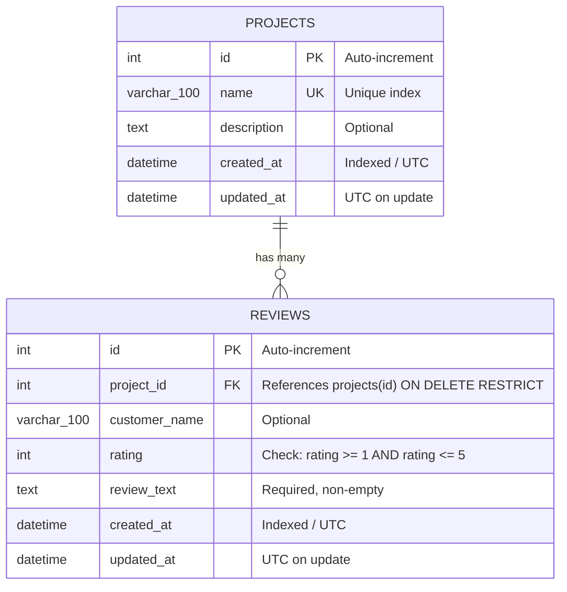

# InsightEngine — Relational Database Guide

## 1. Entity-Relationship (ER) Diagram



---

## 2. Table Specifications & Design Decisions

### Table: `projects`
- **`id`** (`INT`, Primary Key, Auto-increment): Uniquely identifies the project.
- **`name`** (`VARCHAR(100)`, Unique, Not Null): Project names are unique across the system. An indexed unique constraint prevents race conditions and accidental duplicates.
- **`description`** (`TEXT`, Nullable): Detailed narrative description of the service or product.
- **`created_at`** / **`updated_at`** (`DATETIME`, Not Null): Standard UTC audit timestamps.

### Table: `reviews`
- **`id`** (`INT`, Primary Key, Auto-increment): Review record identifier.
- **`project_id`** (`INT`, Foreign Key, Not Null): References `projects.id`. Configured with `ON DELETE RESTRICT` to guarantee that feedback records can never be inadvertently orphaned.
- **`customer_name`** (`VARCHAR(100)`, Nullable): Optional feedback author name.
- **`rating`** (`INT`, Not Null): Constrained by `CHECK (rating >= 1 AND rating <= 5)` at both the database level (in MySQL 8) and the application level (in Pydantic).
- **`review_text`** (`TEXT`, Not Null): Primary textual feedback from the consumer.
- **`created_at`** / **`updated_at`** (`DATETIME`, Not Null): Audit timestamps.

### Indexing Strategy
1. **`ix_projects_name`**: Fast lookup for uniqueness checks during project creation and updates.
2. **`ix_reviews_project_id`**: Accelerates foreign key joins and queries filtering reviews by project.
3. **`ix_reviews_rating`**: Speeds up filtered analytics and ratings queries.
4. **`ix_reviews_project_id_created_at`**: Composite index optimizing chronological pagination of reviews under a specific project (`WHERE project_id = ? ORDER BY created_at DESC`).

---

## 3. Database Sessions & Transaction Management

InsightEngine manages database connections using SQLAlchemy 2.0 with the following connection pool configuration:
- `pool_pre_ping=True`: Tests connections before handing them to a worker thread, recovering automatically from stale socket drops or idle connection timeouts.
- `pool_recycle=3600`: Recycles idle connections every hour to avoid MySQL `wait_timeout` disconnects.
- **Unit of Work**: Injected via FastAPI's `get_db` dependency. A session is isolated per request. If any exception occurs during processing, `db.rollback()` is invoked automatically to preserve data integrity.

---

## 4. Alembic Database Migrations

Alembic provides schema version control, ensuring all schema modifications are tracked, reproducible, and reversible across development and production environments.

### Essential Migration Commands

```bash
# 1. View current migration revision
alembic current

# 2. View revision history
alembic history --verbose

# 3. Apply all pending migrations to MySQL
alembic upgrade head

# 4. Generate a new revision after updating SQLAlchemy models
alembic revision --autogenerate -m "add_new_column_or_table"

# 5. Rollback the most recent migration
alembic downgrade -1
```

---

## 5. Practical SQL Query Reference

Here are standard SQL queries for interacting with the database directly in MySQL:

### 1. List Projects with Review Counts
```sql
SELECT 
    p.id, 
    p.name, 
    COUNT(r.id) AS total_reviews
FROM projects p
LEFT JOIN reviews r ON p.id = r.project_id
GROUP BY p.id, p.name
ORDER BY p.id ASC;
```

### 2. Retrieve Latest Reviews for a Given Project
```sql
SELECT 
    r.id, 
    r.customer_name, 
    r.rating, 
    r.review_text, 
    r.created_at
FROM reviews r
WHERE r.project_id = 1
ORDER BY r.created_at DESC
LIMIT 20 OFFSET 0;
```

### 3. Filter Reviews by Rating Across Projects
```sql
SELECT 
    p.name AS project_name, 
    r.customer_name, 
    r.rating, 
    r.review_text
FROM reviews r
INNER JOIN projects p ON r.project_id = p.id
WHERE r.rating <= 2
ORDER BY r.created_at DESC;
```

### 4. Compute Rating Breakdown and Average Rating for a Project
```sql
SELECT 
    p.id AS project_id,
    p.name AS project_name,
    COUNT(r.id) AS total_reviews,
    ROUND(AVG(r.rating), 2) AS average_rating,
    SUM(CASE WHEN r.rating = 5 THEN 1 ELSE 0 END) AS rating_5_count,
    SUM(CASE WHEN r.rating = 4 THEN 1 ELSE 0 END) AS rating_4_count,
    SUM(CASE WHEN r.rating = 3 THEN 1 ELSE 0 END) AS rating_3_count,
    SUM(CASE WHEN r.rating = 2 THEN 1 ELSE 0 END) AS rating_2_count,
    SUM(CASE WHEN r.rating = 1 THEN 1 ELSE 0 END) AS rating_1_count
FROM projects p
LEFT JOIN reviews r ON p.id = r.project_id
WHERE p.id = 1
GROUP BY p.id, p.name;
```
