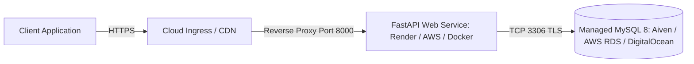

# InsightEngine — Production Deployment Guide

This guide covers deployment procedures for containerized and cloud production environments.

---

## 1. Cloud Architecture & Hosting Strategy

InsightEngine is designed to be deployed as a containerized web service connecting to a managed MySQL instance:



### Recommended Hosting Providers:
1. **API Compute**:
   - **Render**: Web Service deployment using Dockerfile or Native Python environment.
   - **Railway / Fly.io**: Fast containerized deployments with automatic TLS.
   - **AWS App Runner / ECS**: Enterprise production standard with horizontal auto-scaling.
2. **Managed MySQL**:
   - **Aiven for MySQL**: Managed MySQL 8 with TLS, connection pooling, and automated backups.
   - **AWS RDS (MySQL 8)**: Multi-AZ automated failover and encryption at rest.
   - **DigitalOcean Managed Databases**: Cost-effective managed MySQL.

---

## 2. Production Configuration & Environment Variables

Never commit `.env` to source control. Set the following environment variables in your cloud dashboard or secret store:

| Variable | Recommended Production Value | Description |
|---|---|---|
| `APP_NAME` | `InsightEngine` | Service identifier |
| `APP_ENV` | `production` | Environment mode (`production`, `staging`, `development`) |
| `DATABASE_URL` | `mysql+pymysql://<user>:<password>@<cloud-host>:3306/<database>?ssl_ca=/path/to/ca.pem` | Full MySQL connection URI with PyMySQL driver |
| `API_V1_PREFIX` | `/api/v1` | Versioned API route prefix |
| `MAX_UPLOAD_SIZE_MB` | `10` | Maximum file size for CSV ingestion |
| `MAX_CSV_ROWS` | `5000` | Maximum rows allowed per CSV upload |

---

## 3. Database Migration Procedure

Before starting the new container version in production, apply pending database migrations using Alembic:

```bash
# Run migrations using the production DATABASE_URL
alembic upgrade head
```

In automated CI/CD pipelines (e.g., GitHub Actions, Render pre-deploy command):
```bash
# Render Pre-Deploy Command:
alembic upgrade head
```

---

## 4. Production Start Command

In production, run Uvicorn with multiple workers without the `--reload` flag:

```bash
# Recommended command (calculating workers based on CPU cores: 2 * CPU + 1)
uvicorn app.main:app --host 0.0.0.0 --port 8000 --workers 4
```

---

## 5. Deployment Verification Checklist

Once deployed, run this automated verification sequence to confirm the deployment:

### 1. Verify Health Check
```bash
curl -f https://<your-service-domain>/health
# Expected Output: {"status":"ok","app":"InsightEngine","environment":"production"}
```

### 2. Verify Swagger Documentation
Open `https://<your-service-domain>/docs` in your browser.

### 3. Create a Smoke-Test Project
```bash
curl -X POST https://<your-service-domain>/api/v1/projects \
  -H "Content-Type: application/json" \
  -d '{"name": "Production Smoke Test", "description": "Verification project"}'
```

### 4. Create a Review Under the Project
```bash
curl -X POST https://<your-service-domain>/api/v1/projects/1/reviews \
  -H "Content-Type: application/json" \
  -d '{"customer_name": "QA Bot", "rating": 5, "review_text": "Production deployment verified successfully!"}'
```

### 5. Ingest Sample CSV
```bash
curl -X POST https://<your-service-domain>/api/v1/projects/1/reviews/import-csv \
  -F "file=@sample_data/sample_reviews.csv"
```

### 6. Verify Analytics Summary
```bash
curl https://<your-service-domain>/api/v1/projects/1/analytics/summary
```

---

## 6. Security & Hardening Best Practices

1. **Enforce SSL/TLS**: Ensure the database connection string specifies SSL parameters when connecting over public networks.
2. **Non-Root Container**: The provided `Dockerfile` creates and runs as `appuser` (UID 1000) rather than `root`.
3. **CORS Configuration**: Restrict allowed origins in `app/main.py` if serving client browsers.
4. **Rate Limiting**: Place a reverse proxy (e.g. Cloudflare, Nginx, or AWS WAF) in front of the API to protect against brute force and DDoS attacks.
